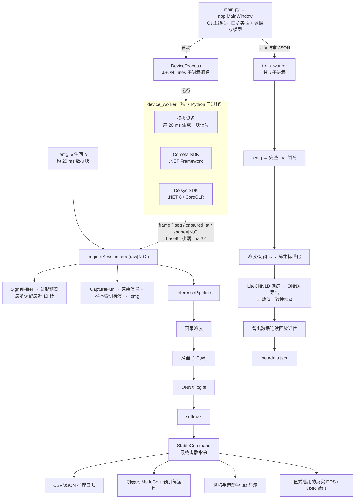
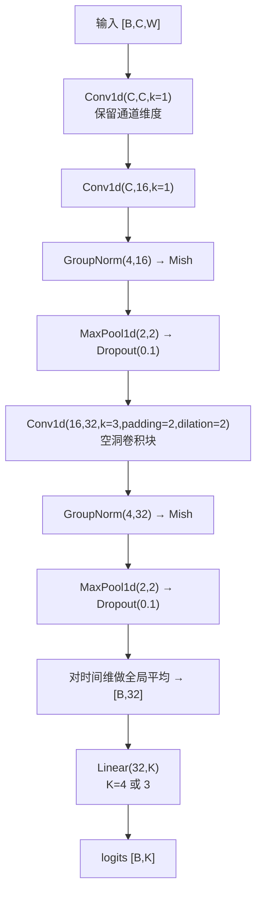
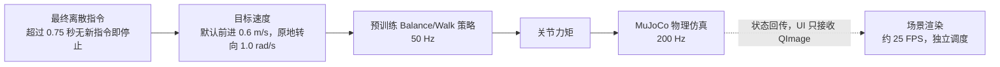

# EMG Lab 开发技术文档

这是一套 Windows 上的肌电分类课堂实验：PySide6 提供操作界面，设备进程采集多通道信号，PyTorch 训练轻量一维 CNN，ONNX Runtime 执行在线推理，MuJoCo 显示机器人或灵巧手。学生可以从界面、信号处理、模型和评估四个方向改进它。

本文对应包含持久导入导出与离线帮助功能的源码。模块路径均相对项目根目录，命令在该目录的 PowerShell 执行。先跑通模拟链路，再通过已有数据、测试和完整界面流程验证开发改动。

## 1 系统整体链路



文件回放从 `.emg` 读出原始信号，以约 20 ms 的数据块进入同一个 `Session.feed`。预览、保存和推理各自有职责；保存的是原始信号，不能把预览滤波后的波形再交给推理滤波一次。

## 2 文件夹架构和修改入口

```text
emg_classroom_demo/
├─ main.py                      启动 Qt 应用
├─ start.cmd / install.cmd      启动与依赖安装
├─ requirements*.txt            基础、训练、机器人、灵巧手依赖
├─ constraints.txt              已验证版本约束
├─ emg_lab/
│  ├─ app.py                    页面、控件、流程编排
│  ├─ theme.py / widgets.py     统一主题、分区与字段布局
│  ├─ icons/                    界面下拉与数值调节图标
│  ├─ help.py                   可搜索的离线帮助窗口，WebEngine 渲染 Mermaid 图，缺组件时回退纯文本
│  ├─ help_assets/              帮助页本地 marked、mermaid 脚本与样式
│  ├─ library.py                统一数据/模型管理页、筛选与用途跳转
│  ├─ catalog.py                文件目录、跨目标传输、离线实验包与清单
│  ├─ transfer.py               持久导入、打包导出、完整性检查
│  ├─ tasks.py                  目标、类别顺序、控制参数
│  ├─ processes.py              JSON Lines 子进程通信
│  ├─ device_worker.py          模拟/Cometa/Delsys 设备进程
│  ├─ engine.py                 Session 状态、回放、预测日志
│  ├─ waveform.py               多通道波形预览
│  ├─ signal.py                 因果滤波、滑窗和配置匹配
│  ├─ capture.py                采样点驱动的动作流程与标签
│  ├─ storage.py                .emg 读写、文件列表、命名
│  ├─ network.py                LiteCNN1D 模型定义
│  ├─ training.py               数据划分、训练、导出、评估
│  ├─ train_worker.py           训练进程入口
│  ├─ inference.py              ONNX 滑窗和稳定指令
│  ├─ evaluation.py             连续回放评分和结果文案
│  ├─ practice.py               实时提示评估、回放对照与 HTML/JSON 报告
│  ├─ robot.py                  机器人场景与 DDS 输出适配
│  ├─ physics/                  G1 物理仿真、运控、环境和相机
│  └─ hand/                     Revo2 模型、场景、USB 输出
│     ├─ poses.py               官方示例目标姿态、可中断单控制器
│     └─ driver/                已验证的达妙/Revo2 驱动层
├─ assets/
│  ├─ g1/                       G1 XML 与网格
│  ├─ policies/                 预训练 Balance/Walk ONNX
│  ├─ classroom/                户外环境、提示贴图
│  └─ revo2/                    左手模型、网格、来源清单
├─ vendor/                      Cometa/Delsys SDK 与私有 wheel
├─ docs/                        操作教程与本技术文档
├─ tests/                       数据、算法、输出生命周期和 UI 测试
├─ scripts/                     完整 UI、场景、资源、DDS 验收
├─ licenses/                    上游许可证与物理资源来源
├─ data/<组别>/                 recordings / models / predictions / evaluations
├─ local/                       请求、日志、验收报告、截图
├─ .venv/                       当前项目虚拟环境
└─ .runtime/                    离线包自带的 Python 3.13；不进入 Git
```

`.venv`、`.runtime` 是运行环境，数据和许可属于本机内容。核心源码位于 `emg_lab`，测试位于 `tests`，文档位于 `docs`。运行时、模型网格与实验数据独立存放。

`SOURCE_PROVENANCE.json`、各资产来源清单和 `licenses/` 保留上游信息；`PACKAGE_MANIFEST.json` 是原始源码包的文件快照，修改后的源码不会再与原快照逐项相同。制作新发行包时应生成新的清单。

### 界面主题与布局

`emg_lab/theme.py` 统一字体、配色、控件状态与样式；`emg_lab/widgets.py` 提供分区卡片和字段布局。`app.py` 组织四步实验流程。组别、数据名称、采集参数、模型名称、学习遍数及推理来源始终展开；运行期间禁用编辑，保留配置可读。评估细节、保存规则和 DDS 技术参数可按需展开。主要操作固定在页底，正文在小窗口中纵向滚动。

## 3 进程 线程和状态边界

| 执行位置 | 职责 | 边界 |
| --- | --- | --- |
| Qt 主线程 | 控件、流程切换、50 ms 定时刷新 | 设备回调通过 Qt Signal 回到界面 |
| 设备子进程 | SDK 加载、采集、模拟信号 | Cometa 与 Delsys 的不同 .NET 运行时隔离 |
| JsonProcess 读取线程 | 读取 stdout，解析事件、检查序列与延迟 | 诊断输出进入 stderr 日志 |
| 训练子进程 | CPU 训练、ONNX 导出与评估 | 通过 JSON 事件报告进度、错误、完成 |
| Session 回放线程 | 按采样率重放原始信号 | 使用停止事件和锁退出 |
| 场景工作线程 | MuJoCo 步进、渲染、状态回传 | UI 接收 QImage，不直接操作物理内部对象 |

设备帧事件包含 `type=frame`、`seq`、`captured_at`、`shape=[N,C]` 和 base64 编码的小端 float32 `data`。每行是一条 JSON。若序列不连续或收到的帧已积压超过 1 秒，进程包装器报告错误并停止。

主界面禁止采集、训练、推理同时开始；场景加载是一个独立的等待状态，准备就绪后才开始采集或回放。导入导出也受相同的忙碌状态限制。

修改代码时保留 `process_id` 过滤，避免已经退出的旧进程事件更新新任务。不要在 stdout 混入调试打印，设备/训练的 stdout 是通信协议。

## 4 实验目标 类别和动作时序

`tasks.py` 是类别的单一来源。类别编号和采集顺序不同：

| 目标 | task_type | classes 编号顺序 | 一个 trial 的顺序 |
| --- | --- | --- | --- |
| robot | ROBOT_DIRECTION_4CLASS | 0 rest, 1 left, 2 right, 3 forward | 3, 0, 1, 2 |
| hand | HAND_COMMAND_3CLASS | 0 rest, 1 open, 2 close | 1, 2, 0 |

缺少目标字段的旧数据按机器人四分类解释。提供了 `classes` 时，顺序必须完全一致。`require_task` 用于导入、训练和回放边界，避免把左转解释成张开。

默认 `prepare_s=3`、`action_s=5`、`rest_s=0`、`trial_count=5`。每个动作的标签从准备结束的采样点开始，采用 `[start_sample,end_sample)` 半开区间，不能按屏幕刷新时间计算。

对于 1000 Hz、每段准备 3 秒和动作 5 秒，第一段动作标签是 `[3000,8000)`。准备阶段信号仍保存，但不当作这段动作的训练标签。停止/放松本身也是一个有完整标签的类别。

## 5 数据结构和二进制格式

新录制的 `.emg` 是 ZIP 容器，包含：

```text
recording.emg
├─ emg.bin
├─ labels.csv
└─ meta.json
```

`emg.bin` 开头是 53 字节小端结构，Python 格式为 `<iiiii10s15sd`：

| 字段顺序 | 类型 | 含义 |
| --- | --- | --- |
| 1 | int32 | 头长度，固定 53 |
| 2 | int32 | 通道数 C |
| 3 | int32 | 通道掩码，保留兼容用途 |
| 4 | int32 | 四舍五入后的采样率 |
| 5 | int32 | 采样点数 N |
| 6 | 10 bytes | 开始日期 |
| 7 | 15 bytes | 开始时间 |
| 8 | float64 | 时长 N/rate |

其后是小端 float32 矩阵 `[N,C+1]`，第一列为相对秒数，其余列按 `channel_ids` 顺序保存原始信号。**精确采样率以 `meta.json` 为准**，传感器编号和顺序以 `channel_ids` 为准。

`labels.csv` 表头：

```csv
trial,start_sample,end_sample,class_id,class_name
1,3000,6000,3,forward
1,9000,12000,0,rest
```

上例只演示前两条标签。现代 schema 中，同一组内的所有类别共用一个 trial 编号。

主要元数据字段：

| 字段 | 用途 |
| --- | --- |
| schema_version / signal_type | 新录制数据为 2 / emg |
| record_id / name / group / created_at | 唯一标识、展示名称、组别、创建时间 |
| target / task_type / classes | 实验目标与有序类别 |
| device / sampling_rate / channel_ids / unit | 信号配置 |
| preprocessing | 滤波与滑窗配置 |
| samples / duration / labels | 点数、时长、标签数 |
| trial_count / completed_trials | 计划组数与已经完整采集的组数 |
| complete / finalized | 是否按计划完成、是否已完成文件保存 |
| action_order / action_seconds / prepare_seconds / rest_seconds | 动作顺序和时长 |

`complete=False` 不一定无法训练：提前结束但 `finalized=True` 且至少一组完整的 schema 2 数据仍可训练。训练会排除不完整 trial。

旧版目录包含 `emg.bin`、`meta.json` 和 `labels.csv`。它的 trial 往往表示单个动作；训练把整个旧文件当作不可拆分单元。新导入会把这三个文件装入 `.emg`，保留旧 schema 和标签含义。

分析数据时优先复用项目读取器，避免另写一个不兼容的二进制解析器：

```python
from emg_lab.storage import read_recording

meta, raw, labels = read_recording("data/G03/recordings/你的文件.emg")
print(raw.shape)            # [N,C]，不含二进制中的时间列
print(meta["channel_ids"])  # 列顺序
print(meta["sampling_rate"])
print(labels[0])           # 半开区间标签
```

## 6 信号处理和切窗

`SignalConfig` 的默认值：

```json
{
  "bandpass": true,
  "notch": true,
  "low_hz": 20.0,
  "high_hz": 450.0,
  "notch_hz": 50.0,
  "window_s": 0.5,
  "step_s": 0.1
}
```

`SignalFilter` 使用四阶 Butterworth 带通设计，带通上限取 `min(450, rate*0.45)`；50 Hz 陷波的 Q 为 30。滤波器转换为 SOS，使用有状态的 `sosfilt`，中间计算为 float64，输出为 float32。它是因果滤波，分块调用保留滤波状态。

训练先对整份记录滤波，再按动作标签取窗。每段跳过前 200 ms，使用 500 ms 窗口、100 ms 步长，不跨标签。1000 Hz 时 `W=500`、`S=100`，模型输入 `[batch,C,500]`。

不要只在训练中改用双向零相位滤波，也不要在每个实时窗口重置滤波状态，否则离线输入与实时输入不同。修改滤波或窗口时，检查预览、训练、推理与评估，并重新训练模型。

## 7 数据划分和防止泄漏

`training.prepare_dataset` 按文件创建时间和路径排序，再按 trial 顺序构造数据单元。合并数据需满足：

- 同一目标、组别、设备、采样率、单位、传感器编号与顺序。
- 相同 `preprocessing`。
- 排除未完成的 trial。
- 拒绝重复 `record_id` 或原始信号 SHA-256 相同的记录。

设完整单元数为 N：

| N | 训练 | 验证 | 测试 |
| --- | --- | --- | --- |
| 1 | 1 | 0 | 0 |
| 2 | 1 | 1 | 0 |
| ≥3 | N - n_val - n_test | max(1, round(N×0.15)) | max(1, round(N×0.15)) |

同一 trial 的重叠窗口不会跨集合。默认 5 组为 3 组训练、1 组验证、1 组测试。旧版的单元是整份记录，而不是单动作。

每通道均值和标准差仅用训练窗口计算：沿 batch 和 time 维统计，标准差下限 `1e-8`。验证和测试使用训练集统计量。导出的 ONNX 内含标准化，因此推理端只负责滤波，不能再次手动标准化。

当前划分适合课堂中的同次采集评估。若研究跨天、跨受试者泛化，应增加按 session、日期或受试者划分的实验，并明确报告对应范围，避免把同一采集中的分数当成跨人效果。

## 8 训练算法与网络结构

`network.LiteCNN1D` 的架构标记是 `LiteCNN1D_channels_v2`：



首层是 C→C，避免在非线性特征提取前就把两块独立肌肉压成一个通道。模型输出是 logits，softmax 由推理层完成。

训练超参数写在 `training.train`：

| 参数 | 默认 |
| --- | --- |
| 优化器 | Adam，学习率 0.001 |
| 损失 | CrossEntropyLoss |
| batch size | 64 |
| epochs | 30，界面允许 1–200 |
| 随机种子 | PyTorch 42、NumPy 42 |
| PyTorch CPU 线程数 | 2 |
| 模型选择 | 最低验证损失；无验证集时取最后一轮 |

训练每轮随机打乱训练窗口顺序，不重新随机划分数据集合。标签为类别索引，不是 one-hot。

导出使用 `torch.onnx.export`，`opset_version=17`、`dynamo=False`，输入名 `emg`，输出名 `logits`，batch 维动态。导出后将 PyTorch 和 ONNX Runtime 的同一窗口输出做 `rtol=1e-4, atol=1e-4` 的一致性比较。

训练模型使用 CPU。`assets/policies` 中的机器人运控 ONNX 是另一个系统的预训练模型，不由学生采集的肌电数据训练。

无需打开界面也可以调用相同的训练入口。在 `local/train-request.json` 保存请求，替换为实际文件路径：

```json
{
  "recordings": ["data/G03/recordings/你的文件.emg"],
  "data_root": "data",
  "name": "实验基线",
  "epochs": 30
}
```

```powershell
.\.venv\Scripts\python.exe -m emg_lab.train_worker local\train-request.json
```

标准输出为每行一条 JSON 事件，类型包括 `progress`、`complete` 和 `error`；完成事件返回模型目录和元数据。Python 内也可调用 `training.train(request, emit=callback)`，返回模型目录 `Path`。批量实验时为每次请求设置可区分的名称，并记录代码版本及数据划分。

## 9 模型结构和导入导出契约

本机模型目录：

```text
data/<group>/models/<模型目录>/
├─ model.onnx
└─ metadata.json
```

`metadata.json` 保存信号配置、目标和类别、`model_id`、`name`、`architecture`、`normalization`、`mean/std`、`history`、`split`、`decision`、`online_evaluation` 和 `complete=True`。

`split` 的每个单元保存 `record_id`、原路径、trial、原始信号哈希、窗口数、采样点区间和各类窗口数。导出模型时这些溯源信息原样保留；换电脑后原路径可以失效，不影响 ONNX 推理，但复现训练还需要对应的数据文件。

`transfer.py` 提供独立于 UI 的接口：

```python
from emg_lab.tasks import ROBOT
from emg_lab.transfer import (
    import_recording, export_recording, import_model, export_model,
)

# root 为本机数据根目录，destination 为已经存在的导出文件夹。
result = import_recording(source, root, ROBOT)
print(result.path, result.reused)
record_file = export_recording(result.path, destination, ROBOT)
model_file = export_model(model_folder, destination, ROBOT)
model_result = import_model(model_file, another_data_root, ROBOT)
```

数据导出为 `.emg`；模型导出为 `.emgmodel`，后者也是 ZIP，**恰好包含** `model.onnx` 和 `metadata.json`。原来的 `model.onnx` 加同目录元数据仍可导入。不支持仅一份 ONNX、pickle、Python 模型脚本或引用外部权重的 ONNX。

导入先验证再复制：目标、配置、数据头与标签；模型还进行 ONNX 结构检查和一个全零窗口的实际推理，检查类别数及有限输出。单个窗口验证只证明接口能运行，预测质量仍需留出数据评估。

导入按三个数据成员或两个模型成员的内容哈希去重，保留组别和元数据。ZIP 压缩方式或容器时间戳不同不影响去重；内容有变化则视为不同对象，训练端仍会检查重复记录和信号。

压缩包不按其中的路径直接解压，仅读取固定名称成员，拒绝缺失、多余、重复或带路径的成员。内容大小上限：数据 512 MiB、模型 128 MiB、元数据 4 MiB。导出以独占创建的新文件名发布，失败时清理本次半成品，不覆盖源文件。

导入导出目前在界面线程同步完成，适合课堂大小的文件。要处理大量文件，可把 `transfer` 调用放到带取消与进度信号的工作线程；保持复制完成前不改界面选择、错误不影响其他文件的行为。

### 统一管理与离线实验包

`catalog.Entry` 统一表示数据与模型，按文件原始日期、类型、目标、组别、设备、名称/编号筛选。`library.LibraryWidget` 只负责界面与操作编排，调用已有 `transfer` 进行单文件验证和传输。隐藏筛选结果会取消勾选，避免不可见文件被导出。`app.use_library` 在切换实验前校验用途、任务、训练组别和输入配置。

`export_bundle(selected, entries, destination)` 创建新的实验包目录，按模型 `split` 中的 `record_id` 自动收集本机可找到的训练数据。数据和模型文件沿用 `.emg` 与 `.emgmodel` 格式，不修改内容和历史路径。清单最后写入，`complete=True` 才可导入；失败保留明确的未完成标记。

`manifest.json` 的 `format=emg-classroom-bundle`、`version=1`；`files` 为相对路径、SHA-256、类型、编号、目标、组别、名称、日期和关联记录编号；`missing_training_record_ids` 列出缺失记录。`source` 保存核心源码、依赖约束、课堂场景 XML 的逐文件哈希与汇总指纹，以及主要库版本。它不是完整资源包的认证签名，也不强制阻止学生使用修改后的代码。

`bundle_files(folder)` 在导入前验证所有清单路径均在该目录内、无重复、文件大小与哈希正确，且文件类型/编号/目标与清单一致；随后每个文件仍经过 `transfer` 的完整验证。单文件失败按批量导入方式报告，已成功项保留。实验包不包含源码、解释器或 MuJoCo 全部资源，教师需另发同版本完整源码资源包。

## 10 在线推理和最终指令

`InferencePipeline` 读取模型元数据，检查目标和输入配置，创建独立的因果滤波器与 ORT CPU session。每得到足够的新点数就产生一个窗口，送入 `[1,C,W]`。

对 logits 减去最大值再求指数得到 softmax 概率。`StableCommand` 默认：

```json
{"threshold": 0.65, "hold": 3}
```

如果最大概率不足阈值，候选类别视为 0；停止立即输出。运动候选必须连续满足 3 次；切换方向未稳定时先停止。默认 100 ms 步长下，3 次连续判定覆盖约 200 ms 的窗口间隔，完整响应还包含窗口积累、滤波、计算和界面/输出刷新时间，不能简单宣称“延迟就是 200 ms”。

每个结果包含 `probabilities`、`raw_class`、`filtered_class`、`sample_end`。旧模型缺少 `decision` 时采用默认参数。修改默认值不会自动改写已经保存了 decision 的模型。

预测 CSV 表头为：

```text
机器人：seconds,raw_class,stable_class,p_rest,p_left,p_right,p_forward
灵巧手：seconds,raw_class,stable_class,p_rest,p_open,p_close
```

旁边的 JSON 保存模型路径/编号、实时或回放来源、输入配置、判定门限、目标和控制配置。`recording` 只在回放时填写。

## 11 评估指标和解释边界

离线窗口分类正确率用于观察分类器，`test_accuracy` 和 `confusion_matrix` 保留这种含义。界面优先显示 `online_evaluation.command` 的最终指令成绩。

`evaluate_recordings` 连续回放整份记录，保留准备阶段的滤波和判定历史，不在标签边界重置状态。只对选定的留出 trial 计分，要求完整窗口位于动作段内、且起点已经越过该段前 200 ms。

报告包括：

- `split`：test 或 validation，后者明确标为尚未独立测试。
- `protocol=continuous_recording_replay`。
- `raw` 和 `command`：原始分类与稳定指令的正确率、混淆矩阵。
- `per_class`：每类 support、correct、recall。
- 记录数、trial 数、动作段数和计分窗口数。

窗口有重叠，support 不是独立动作次数。没有留出数据时不生成虚构分数。测试数据不用于选择训练轮数或调整置信度阈值；改算法时应固定划分并记录对照结果。

## 12 场景和真实输出边界

实时与回放调用同一 `RobotScene.start('open')`；区别只在 `Session` 的输入。`SceneWindow.source` 仅影响标题和说明，不参与场景文件选择。采集调用 `start('sample')`，按预设标签增加地面动作提示。两种推理都由 `InferencePipeline` 的稳定指令驱动机器人，回放标签不作为控制输入。当前基础场景标识为 `g1_outdoor_15m_v1`。新增金币模式使用同一机器人和物理场景，增加无碰撞金币、确定性路线和独立计分；接口详见 `COMPETITION.md`。


机器人链路（策略 50 Hz、物理 200 Hz、渲染约 25 FPS）：



灵巧手使用官方 Revo2 左手模型和 mimic 关系做运动学显示。四指归一化开合速度 75%/秒，张开趋近 0%，握合趋近 100%，停止保持当前位置；拇指固定 FLEX 24°、AUX 30°。该画面没有实现接触力或物体抓取仿真。

真实机器人复用 `bsi_robot_base`，DDS 以 10 Hz 发布，结果过期 1 秒回停止。默认 Domain 0、Topic `bsi/cmd_discrete`。本地到线上类别映射为：

| 本地类别 | DDS 类别 |
| --- | --- |
| 0 rest | 0 IDLE |
| 1 left | 2 TURN_LEFT |
| 2 right | 3 TURN_RIGHT |
| 3 forward | 1 FORWARD |

真实灵巧手由 `hand/output.py` 和 `hand/driver/` 处理互斥、连接、初始化、命令与停止。界面连接时先待机，只有真实肌电的实时推理才启用动作；停止推理保留连接，断开才释放。

修改界面或算法时，保留模拟设备/回放不触发真实输出的门禁、超时停止和错误回传。离线测试使用模拟控制器与 DDS loopback，不把物理设备接机操作混入自动化测试。

## 13 开发环境 测试和定位问题

学生离线包自带 Python 3.13.5，运行 `install.cmd` 建立独立 `.venv`。Delsys 所需的 .NET 8 与设备许可由教师另行准备；如果在 `.runtime/dotnet` 安装了 .NET，`start.cmd` 会配置其路径。依赖版本由 `requirements-all.txt` 和 `constraints.txt` 管理，CPU 即可训练和推理，3D 另需 OpenGL。

```powershell
# 依赖和自动化测试
.\.venv\Scripts\python.exe -m pip check
.\.venv\Scripts\python.exe -m pytest -q

# 资源校验与完整流程
.\.venv\Scripts\python.exe scripts\download_robot_assets.py --check
.\.venv\Scripts\python.exe scripts\check_hand_assets.py
.\.venv\Scripts\python.exe -m scripts.check_ui --physics
.\.venv\Scripts\python.exe -m scripts.check_hand_ui
.\.venv\Scripts\python.exe -m scripts.check_dds
.\.venv\Scripts\python.exe -m scripts.check_help

# 专项验证
.\.venv\Scripts\python.exe -m pytest -q tests/test_transfer.py tests/test_student_features.py
```

`check_ui --physics` 验证机器人实际界面、采集、训练、实时解码、回放和退出；`check_hand_ui` 使用默认 5 组并验证三分类、3D、停止保持和回放；`check_dds` 只使用 loopback、Domain 153；`check_help` 在桌面会话验证帮助窗口的 Mermaid 渲染与四个标签页加载，报告写入 `local/help-check.json`。

| 问题 | 先看哪里 |
| --- | --- |
| 设备连接失败 | `local/device_worker.log`、设备驱动和传感器配置 |
| 训练或导出失败 | `local/train_worker.log`、训练请求 JSON、`training.py` |
| 导入包失败 | `transfer.py` 的成员/配置检查，旁边的元数据是否完整 |
| 推理行为不符 | 模型 `decision`、`classes`、输入配置、预测 CSV |
| 3D 异常 | 控制台/启动日志、OpenGL 驱动、场景资源校验 |
| UI 按钮被遮挡 | `test_gui_refinement.py`，900×600 布局 |
| 修改后子进程仍运行旧代码 | 确认编辑的是启动目录，完整关闭应用后重启 |

新测试应验证真实行为：导出后到另一个数据根目录重新导入并推理；删除外部源后本机副本仍可读取；混合错误文件时成功项保留；忙碌时不能改变当前模型。仅比较函数返回的字符串无法证明实验链路可用。

最后保留原始数据和旧模型，记录改动、参数、测试结果及已知限制。算法改动需重新训练；已有 ONNX 不会因为 Python 网络定义改变而自动升级。


## 14 第一节课版本的任务与评估接口

本节描述新增能力；前文的机器人四类、灵巧手三类仍作为兼容基线保留。新增任务不改变旧文件的类别含义，不实现学生的混合或连续解码算法。

| 选择键 | task_type | class_id 从 0 起的顺序 |
| --- | --- | --- |
| robot | ROBOT_DIRECTION_4CLASS | rest, left, right, forward |
| robot7 | ROBOT_DIRECTION_7CLASS | rest, left, right, forward, backward, strafe_left, strafe_right |
| hand | HAND_COMMAND_3CLASS | rest, open, close |
| hand5 | HAND_POSE_5CLASS | rest, open, fist, point, victory |

界面在首页选择实验线；采集、训练和使用模型三页的“任务方案”共享同一个 Task。任一页切换会同步另外两页并过滤数据与模型。设备页只负责设备与通道；跨实验线通过“切换实验”或数据管理用途跳转完成。

`Task.key` 表示目标种类 robot/hand，`Task.selector` 表示分类方案选择键。元数据匹配以 `task_type + classes` 为准，不能仅比较目标种类。数据管理用途跳转与训练合并均遵守该规则。模型输出维度来自类别表。

**采集。** `CaptureRun` 默认保留原有固定顺序，新增 `random_order=True` 可按完整 trial 独立打乱。元数据包含实际顺序、随机种子与原有逐段标签。信号仍保存为原始 float32，提示标签按样本时钟建立。真实受试者是否按提示完成动作需人工检查；`collection_notes` 保存选填的操作者代号、佩戴轮次、通道位置和动作映射；默认值按组别与任务保存在 `data/.capture_notes.json`。

**机器人。** `physics/commands.py` 添加后退与左右侧移，目标速度分别为 -0.4 m/s 与侧向 ±0.4 m/s。`Simulation` 对平移指令保持方向角，原有预训练行走/平衡策略接收速度目标。七类在准备阶段均显示中文与倒计时，动作阶段均显示文字和地面符号。后退、侧移复用前进直箭头并按机身方向旋转，转向保留弯箭头；文字贴图由 `scripts/build_cue_textures.py` 生成。该扩展只启用 MuJoCo；原 DDS 四类接口未扩展。

**灵巧手。** `hand/poses.py` 提供四个官方仿真示例姿态以及停止保持。角度顺序对齐本地 URDF 的六个主动关节，通过 `HandModel.set_angles` 检查有限值与关节范围，再更新 mimic 关节。`PoseMotion` 是唯一姿态状态机：先伸四指、调整拇指、再弯四指；从当前插值状态切换，新目标替代旧序列，重复目标不重启，停止清空后续阶段。速度上限为 0.9 rad/s。来源、角度表和验证边界见 `docs/HAND_POSES.md`。五类没有 USB 真机映射。

**评估链路。** `Session.start_inference(..., assessment=True)` 创建 `BasicAssessment`。实时来源生成每类两次的随机提示序列，准备/动作各 3 秒；回放来源复制记录标签并排除已标记无效的 trial。每个新推理结果都进入计分器，不能使用 UI 最后一次预测重复计分。提示仅供显示和计分，绝不进入解码器或输出控制。计分窗口须完整处于动作开始 200 ms 后至动作结束之间。JSON 保存原始分类与稳定指令矩阵、每类统计、随机种子、模型/记录编号与各段首次正确输出时间；HTML 展示主要结果。首次正确输出时间包含人的反应、窗口、滤波和稳定判定，不是纯模型推理延迟。

报告位于 `data/<group>/evaluations/`。到达结尾自动结束；手动停止保留未完成标记。模型关联记录回放明确标注自查，模拟输入明确标注流程验证。自由练习不生成提示评估，不包含比赛计时、金币和完成率。

**验证入口。** `tests/test_lesson1.py` 覆盖任务兼容、打乱采集、姿态范围与所有目标切换、评分时序以及七向控制。`scripts/check_lesson1_ui.py robot7` / `hand5` 启动真实 Qt/设备子进程与 3D 场景，自动完成模拟采集、训练、逐类实时推理与回放评估。此类模拟测试不能替代 Cometa 实采与真机验证。


## 15 课堂记录与软件自检

`collection.py` 提供简短采集记录与信号状态提示。超过 1 秒没有新帧，或最近 2 秒原始通道极差为零时提示检查设备；不按振幅判定健康，不自动删除数据。

采集中 `CaptureRun.reject_trial()` 写入 `meta.json.rejected_trials`，格式为 `[{"trial": 2, "reason": "动作做错"}]`。`completed_trials` 仍表示完整采集组数，`usable_trials` 表示其中未被标记的组数；原始信号与标签不改写。训练先按整组排除，再划分训练/验证/测试。旧数据缺少此字段时按原规则读取。回放仍播放原始信号，基础评估仅计未被排除的动作段。

`practice.py` 的报告版本为 2。停止误动作比例是停止标签段内非停止指令窗口数除以有效窗口数；连续错误运动开始或错误指令改变记一次事件。每段的 `switches` 为相邻有效指令变化次数，`first_correct_seconds` 为从动作提示开始到首次正确有效窗口末端的秒数；`longest_correct_seconds` 为连续正确结果首末时刻的跨度，单个结果跨度为零。这些指标衡量解码指令，不能替代实际位置或力的测量。

`reports.py` 汇总已有基础评估与金币报告，导出 HTML、JSON 及现有比赛指令日志，不重新计分。模型名称、输入来源与记录编号仍保留在原报告中。

Windows 学生离线包内含 `.runtime/python313` 和 `wheelhouse`。`install.cmd` 调用 `scripts/bootstrap.py` 校验依赖后创建本目录的 `.venv`；重复运行可补完中断安装。`检查环境.cmd` 检查网络前向计算、机器人物理站稳、手部姿态与两种 3D 渲染，结果写入 `local/classroom_check.json`，不会连接真实设备。测试命令仍为 `.venv\Scripts\python.exe -m pytest -q`。


## 16 扩展分类任务

“方案”表示一整套分类任务，“类别”表示其中一个输出。例如“机器人七类”是一个方案，包含停止、前进等七个类别。新增动作时应另建一个方案并保留旧方案，而不是修改旧编号的含义。

1. 在 `tasks.py` 新增 `Task` 并注册到 `TASKS`。使用新的 `task_type`，明确类别代码、中文名称及采集顺序；编号 0 仍表示停止。各方案的 ID、名称和类别顺序写入数据及模型元数据。
2. 三页方案列表、采集标签、基线分类输出维数、模拟输入选项与概率条会读取这份定义；但新增选项不等于新增控制能力。需同时实现场景/控制器中的动作映射与提示，必要时扩展模拟信号生成器。
3. 新动作必须补采对应数据并重新训练。旧模型不会因修改类别表而自动识别新动作；任务和类别顺序不符会被拒绝。
4. 增加采集、训练、回放与动作切换检查。自定义任务先在仿真练习，正式比赛仍须遵守教师冻结的输出接口和速度规则。

这种注册方式针对离散分类。连续/混合控制应输出速度向量或连续幅度，需要相应标签、训练目标与控制适配，不应强行表达为“再加一个类别”。机器人连续接口见 `COMPETITION.md`。本版没有添加任意新动作的图形编辑器，避免出现只有名称而没有执行逻辑的任务。
